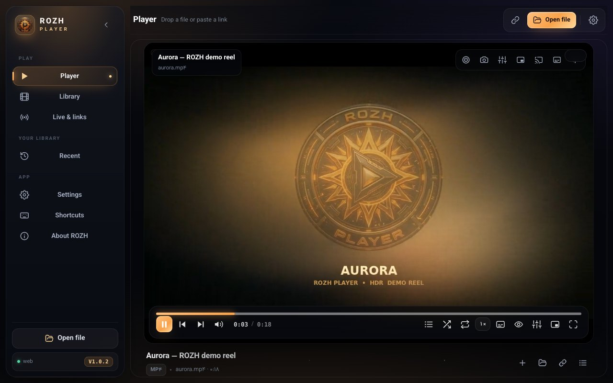
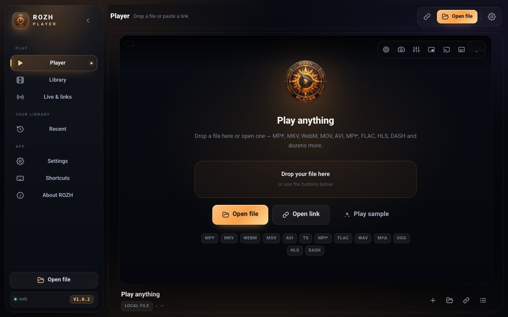
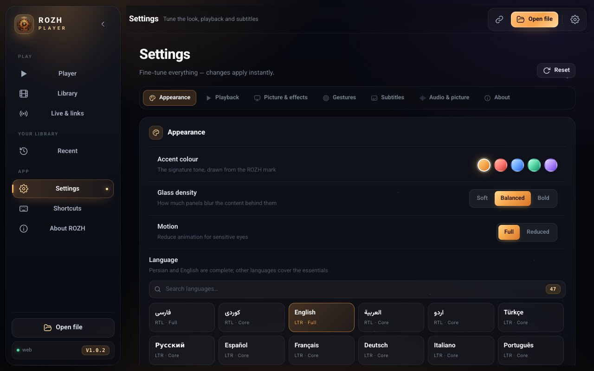
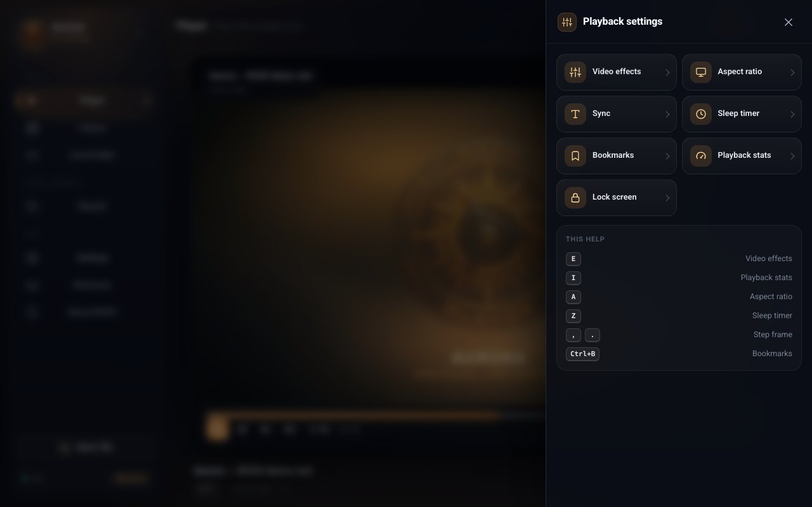
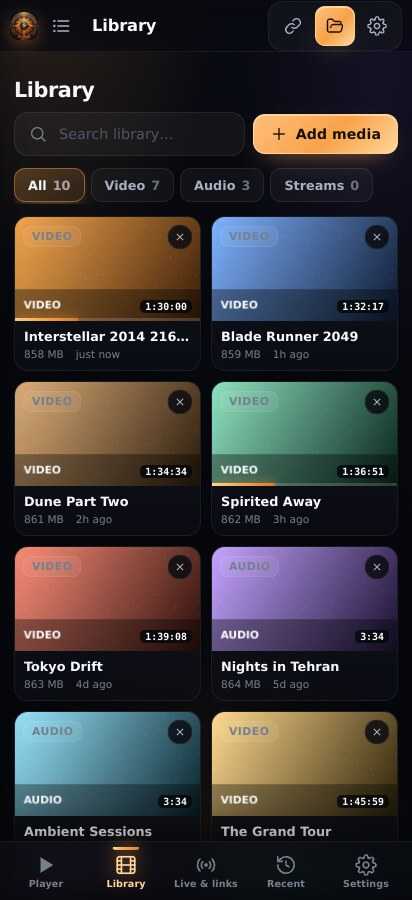

# ROZH Player

<div align="center">
  

  **A lightweight, beautiful, universal media player**
  **Windows · macOS · Linux · Android · Android TV · Web**

  [](.github/workflows/ci.yml)
  [](../../releases/latest)
  [](https://tauri.app)
  [](LICENSE)
  [](#languages)
</div>

<div align="center">
  
</div>

---

## Contents

- [Download](#download)
- [Updates](#updates)
- [Why ROZH](#why-rozh)
- [Features](#features)
- [Run and install](#run-and-install)
- [Formats](#formats)
- [Keyboard shortcuts](#keyboard-shortcuts)
- [Languages](#languages)
- [Automated releases (CI)](#automated-releases-ci)
- [Project layout](#project-layout)
- [License](#license)

---

## Download

Every version ships ready-to-install builds for all platforms on the
[Releases](../../releases/latest) page:

| Platform | File |
| --- | --- |
| **Windows 10/11 (x64)** | [ROZH-Player_1.0.8_x64-setup.exe](https://github.com/Dark-Sky07/Rozh-Player/releases/download/v1.0.8/ROZH-Player_1.0.8_x64-setup.exe) |
| **macOS — Apple Silicon (M1–M4)** | [ROZH-Player_1.0.8_aarch64.dmg](https://github.com/Dark-Sky07/Rozh-Player/releases/download/v1.0.8/ROZH-Player_1.0.8_aarch64.dmg) |
| **macOS — Intel** | [ROZH-Player_1.0.8_x64.dmg](https://github.com/Dark-Sky07/Rozh-Player/releases/download/v1.0.8/ROZH-Player_1.0.8_x64.dmg) |
| **Linux (Debian/Ubuntu)** | [ROZH-Player_1.0.8_amd64.deb](https://github.com/Dark-Sky07/Rozh-Player/releases/download/v1.0.8/ROZH-Player_1.0.8_amd64.deb) |
| **Linux (Fedora/RHEL/openSUSE)** | [ROZH-Player-1.0.8-1.x86_64.rpm](https://github.com/Dark-Sky07/Rozh-Player/releases/download/v1.0.8/ROZH-Player-1.0.8-1.x86_64.rpm) |
| **Linux (any distribution)** | [ROZH-Player_1.0.8_amd64.AppImage](https://github.com/Dark-Sky07/Rozh-Player/releases/download/v1.0.8/ROZH-Player_1.0.8_amd64.AppImage) |
| **Android 7.0+ (phones, tablets)** | [ROZH-Player-1.0.8.apk](https://github.com/Dark-Sky07/Rozh-Player/releases/download/v1.0.8/ROZH-Player-1.0.8.apk) |
| **Android (Google Play bundle)** | [ROZH-Player-1.0.8.aab](https://github.com/Dark-Sky07/Rozh-Player/releases/download/v1.0.8/ROZH-Player-1.0.8.aab) |
| **Android TV (dedicated build)** | [ROZH-Player-TV-1.0.8.apk](https://github.com/Dark-Sky07/Rozh-Player/releases/download/v1.0.8/ROZH-Player-TV-1.0.8.apk) |
| **Android TV (Google Play bundle)** | [ROZH-Player-TV-1.0.8.aab](https://github.com/Dark-Sky07/Rozh-Player/releases/download/v1.0.8/ROZH-Player-TV-1.0.8.aab) |
| **Web / PWA** | [rozh-player-web.zip](https://github.com/Dark-Sky07/Rozh-Player/releases/download/v1.0.8/rozh-player-web.zip) — unzip and serve as static files |

> Builds are unsigned: Windows may show SmartScreen and macOS Gatekeeper needs a
> right-click → **Open** on first launch. Details in the
> [release notes](docs/RELEASE_NOTES.md).

## Updates

ROZH updates itself from inside the app — **Settings → Updates**:

- **Windows, macOS, Linux** — the next version is downloaded in the background,
  verified against the embedded public key and started; the app relaunches into
  it. Nothing to uninstall, no installer to hunt for.
- **Android, Android TV** — the matching APK is downloaded through Android's
  download manager and the package installer takes over; the app is replaced in
  place. Every release is signed with the same key and a higher version code, so
  Android always treats it as an upgrade.
- A quiet check runs on every launch (it can be switched off) and only talks to
  the public release feed.

Linux `.deb`/`.rpm` installations are reported but updated by your package
manager; the AppImage updates itself.

## Screenshots

| | |
| --- | --- |
|  |  |
|  |  |

<div align="center">
  
  <br />
  <sub>ROZH Player on a phone.</sub>
</div>

## Why ROZH

**ROZH** comes from *rozh* — dawn, first light. The logo is the same burning
sun, and the whole interface is built from that palette: ember gold on
midnight black. Three simple rules:

1. **Lightweight** — no UI framework, just TypeScript and hand-written CSS.
   The app itself is ~130 kB of JavaScript (HLS and DASH players are lazy
   loaded and only fetched when a stream needs them).
2. **Universal** — video, audio, live streams, subtitles, equalizer, queue,
   resume, remote-control navigation, and a native FFmpeg fallback on desktop.
3. **Beautiful** — layered glass surfaces, soft depth, restrained motion, and
   full respect for `prefers-reduced-motion`.

## Features

### Interfaces
- **Desktop**: floating glass panels around a persistent rail
- **Phone**: a real mobile shell — compact app bar, thumb-sized controls, a
  bottom tab bar with safe-area padding, no hover-only affordances, 2–3 column
  grid, `dvh`-aware player that survives rotation
- **Android TV**: a dedicated, remote-first 10-foot home with a persistent
  left navigation rail, media-led feature area, resume and recent shelves, and
  separate video/music rows. Large focus targets, overscan-safe spacing, D-pad
  spatial navigation and remote transport keys; no pointer-only controls
- 47 interface languages including Persian, Kurdish and full RTL

### Playback
- Custom player surface on top of `<video>` with a complete control set
- **HLS** (`.m3u8`) and **DASH** (`.mpd`) with lazy loading and manual/auto quality
- Open local media by drag-and-drop, the native file dialog, or the Open button
- **Queue**, shuffle, repeat (one / all)
- **Resume where you left off** — every file restarts at the second you stopped
- Playback speed 0.25×–4× with pitch preservation
- **A-B loop**, 5 s / 30 s seeks, frame stepping (`, .` or `Alt + ←/→`)
- Aspect ratio (auto / 16:9 / 4:3 / 21:9 / fill), rotate, horizontal & vertical flip,
  picture effects (brightness, contrast, saturation, gamma)
- Sleep timer, screen lock, scene bookmarks, technical stats panel, subtitle sync
- **Frame capture** (PNG/JPEG) with automatic naming
- Picture-in-picture, Cast/AirPlay, OS media keys and media session metadata
- Progress bar with buffered ranges, time tooltip, auto-hiding controls

### Subtitles
- SRT, WebVTT and **ASS/SSA rendered by libass** (JASSUB — accurate styling)
- Drop a `.srt`/`.vtt`/`.ass` file onto the player to load it
- Size, colour and edge style (outline / shadow / box) with a live preview
- Per-file sync offset (±10 s) for text tracks

### Audio
- Real **six-band equalizer** (Web Audio, Biquad filters) plus Bass/Voice presets
- The audio graph is only built while the equalizer is on, so cross-origin
  streams are never silenced; volume and mute are owned by one code path
- Spinning artwork view for audio-only files
- Volume slider, mute, per-source normalization

### Library and history
- **Android device library** — on every launch the phone and TV builds index all
  video and audio on the device (MediaStore) and add it to the library, with
  thumbnails, so nothing has to be picked file by file
- **Folder picker** (Storage Access Framework) for SD cards, Downloads and USB
  sticks; the grant is persisted, so the folder is re-indexed every launch too
- Local library with **automatic poster frames** captured off the playback path
- Search and filters (video / audio / network)
- Playback history with progress percentage and "continue from…"
- Everything stays on your device: no account, no server, no telemetry

### Experience
- **47 languages** with a searchable picker and automatic RTL/LTR direction;
  English is the default, Persian and Kurdish are fully translated
- Five accent colours, three glass levels
- **TV mode (10-foot UI)**: larger type, visible focus ring, remote navigation
- Mobile tab bar, collapsing desktop rail, touch gestures (swipe for volume and
  brightness, double-tap to seek, hold for 2× speed)
- Ambient embers, soft transitions, full reduced-motion support

## Run and install

### Web (fastest path)

```bash
npm install
npm run dev        # http://localhost:5173
npm run build      # static output in dist/
```

The web build is a PWA — use "Install" in your browser to run it like a
standalone app.

### Desktop — Windows, macOS, Linux

Prerequisites: [Rust](https://rustup.rs), Node 18+, and the Tauri system
packages (on Linux: `libwebkit2gtk-4.1-dev build-essential curl wget file
libxdo-dev libssl-dev libayatana-appindicator3-dev librsvg2-dev`).

```bash
npm install
node scripts/fetch-ffmpeg.mjs     # native engine for exotic formats (optional, recommended)
npm run tauri:dev                 # run the desktop app
npm run tauri:build               # build installers
```

Outputs:

| System | File |
| --- | --- |
| Windows | `src-tauri/target/release/bundle/nsis/*.exe` (and `.msi`) |
| macOS | `.../bundle/dmg/*.dmg` |
| Linux | `.../bundle/deb/*.deb`, `.../bundle/appimage/*.AppImage` |

### Android and Android TV

```bash
npm run tauri android init                 # first time only
node scripts/patch-android-tv.mjs          # cleartext, permissions, leanback
npm run tauri android dev                  # run on a device or emulator
npm run tauri android build -- --apk       # phone / tablet package
```

`patch-android-tv.mjs` is not optional: it turns on `usesCleartextTraffic`
(Android 9+ blocks every plain `http://` stream without it), declares the network
permissions, enables hardware acceleration and adds the LEANBACK launcher
category so the same APK shows up on TVs.

**Dedicated Android TV package:**

```bash
node scripts/make-tv-variant.mjs                       # applicationId, banner, landscape
VITE_TV_BUILD=1 npm run tauri android build -- --apk   # 10-foot UI baked in
```

That produces an app labelled **ROZH Player TV** with its own package id
(`…rozh.player.tv`), a 320×180 launcher banner, `leanback` required, touchscreen
not required and a landscape-locked activity. `VITE_TV_BUILD=1` forces TV mode
from the first frame instead of relying on device detection.

### Remote control (Android TV)

| Key | Action |
| --- | --- |
| `▲ ▼ ◀ ▶` | Move the focus ring between controls (spatial navigation) |
| `OK` / `Enter` | Activate the focused control; on the video surface: play / pause |
| `▲ ▼` on the video surface | Bring the control bar up and focus it |
| `◀ ▶` on the video surface | Seek by the configured step |
| `Back` / `Esc` | Close the sheet, hide the controls, then return to TV Home |

## Formats

| Runtime | Video | Audio | Subtitles | Streaming |
| --- | --- | --- | --- | --- |
| Web / desktop (WebView) | MP4 (H.264/H.265*), WebM (VP8/VP9/AV1), Ogg | MP3, AAC/M4A, FLAC, WAV, Opus, Ogg | SRT, VTT, ASS/SSA | HLS, DASH |
| Any Tauri build (desktop, Android, TV) | + MPEG-TS / M2TS / HTTP-FLV through the bundled software demuxer | + AC3/EAC3 in TS | SRT, VTT, ASS/SSA | HLS, DASH, raw TS, FLV |
| Desktop with native FFmpeg | **MKV, AVI, MOV, TS, M2TS, WMV, FLV, 3GP, ProRes…** | AC3, DTS, EAC3, ALAC, WMA, APE… | all | all |

\* H.265/HEVC depends on the codec installed in the operating system.

On desktop, if the webview cannot decode a file, ROZH automatically remuxes it
with FFmpeg — or transcodes when necessary — without asking you anything.

## Keyboard shortcuts

| Key | Action |
| --- | --- |
| `Space` / `K` | Play / pause |
| `←` `→` | Seek 5 s back/forward (`Shift`: 30 s) |
| `↑` `↓` | Volume |
| `J` / `L` | Seek 10 s back/forward |
| `M` | Mute |
| `F` | Fullscreen |
| `P` | Picture-in-picture |
| `V` | Subtitles |
| `C` | Capture frame |
| `N` / `B` | Next / previous |
| `E` / `I` / `A` | Effects / stats / aspect ratio |
| `Z` / `D` | Sleep timer / subtitle sync |
| `Ctrl/⌘ + B` | Bookmark the current scene |
| `Q` | Queue |
| `[` / `]` | Playback speed |
| `,` / `.` or `Alt + ←/→` | Frame step |
| `0`–`9` | Jump to 10 %–90 % |
| `Ctrl/⌘ + O` | Open a file |
| `Ctrl/⌘ + L` | Open a link |
| `Ctrl/⌘ + ,` | Settings |

## Languages

47 interface languages, all reachable from **Settings → Appearance**. English,
Persian (فارسی) and Kurdish (کوردی) carry complete translations; the rest cover
the navigation, transport and settings vocabulary and fall back key by key to
English, so the UI never shows a raw key.

Persian, Kurdish, Arabic, Hebrew, Urdu and Pashto switch the whole layout to RTL
automatically.

## Automated releases (CI)

Pushing a tag that matches `v*` builds the full matrix and publishes a new
GitHub release with every asset attached:

```bash
git tag v1.0.8 && git push origin v1.0.8
```

| Job | Tooling | Output |
| --- | --- | --- |
| Windows | `windows-latest` + NSIS | `*-setup.exe` |
| macOS | `macos-latest`, both architectures | `aarch64.dmg` · `x64.dmg` |
| Linux | `ubuntu-22.04` | `deb` · `rpm` · `AppImage` |
| Android | JDK 17 + NDK 27 | `apk` · `aab` (phone **and** TV builds) |
| Web | `ubuntu-latest` | [rozh-player-web.zip](https://github.com/Dark-Sky07/Rozh-Player/releases/download/v1.0.8/rozh-player-web.zip) |
| Manifest | after every desktop job | `latest.json` (in-app updates) |

The release body is generated from [docs/RELEASE_NOTES.md](docs/RELEASE_NOTES.md).

---

## Project layout

```
rozh-player/
├── index.html                 # HTML shell + boot screen
├── src/
│   ├── main.ts                # entry point
│   ├── core/
│   │   ├── player.ts          # playback engine, controls, subtitles, equalizer
│   │   ├── shell.ts           # app shell, routing, library
│   │   ├── store.ts           # settings (localStorage) + library (IndexedDB)
│   │   ├── native.ts          # Tauri bridge (asset protocol, FFmpeg engine)
│   │   ├── langs.ts           # language registry and partial dictionaries
│   │   ├── i18n.ts            # translation dictionary + helpers
│   │   ├── ui.ts              # toasts, drawers, modals, popovers
│   │   ├── icons.ts           # inline SVG icon set
│   │   └── util.ts            # helpers and platform detection
│   ├── views/                 # library, live, history, settings, about
│   └── styles/                # theme / app / overlays / player-extras / studio
├── src-tauri/                 # native Rust shell + Tauri config
│   └── src/lib.rs             # tray, FFmpeg remux, probe, reveal-in-folder
├── public/                    # font, icons, demo media, libass
├── scripts/                   # libass copy, FFmpeg fetch, Android + Android TV patchers
└── docs/                      # architecture, build, third-party, release notes
```

More detail: [docs/ARCHITECTURE.md](docs/ARCHITECTURE.md) and
[docs/BUILD.md](docs/BUILD.md).

## License

Project code is [MIT](LICENSE). Third-party components keep their own licences —
see [docs/THIRD-PARTY.md](docs/THIRD-PARTY.md).

<div align="center">
  <sub>Crafted with ❤ for people who love film and music.</sub>
</div>
